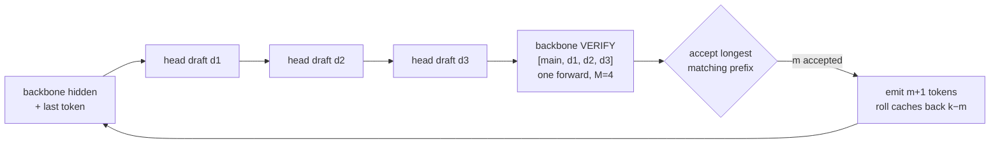
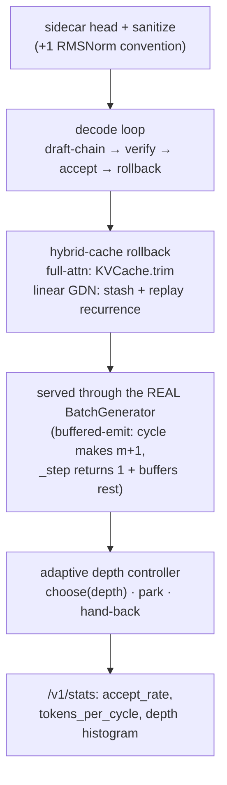
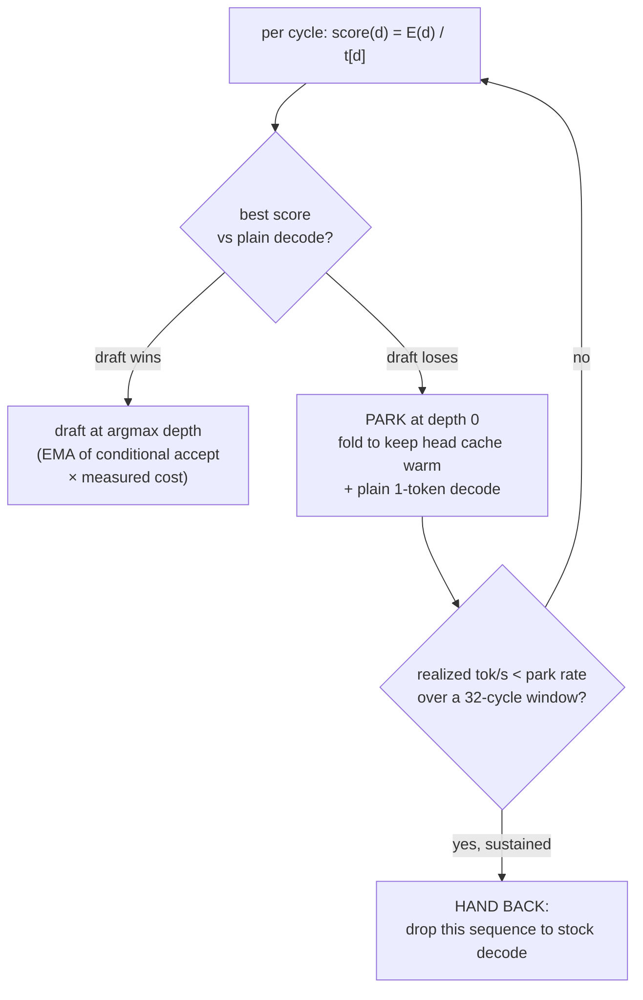
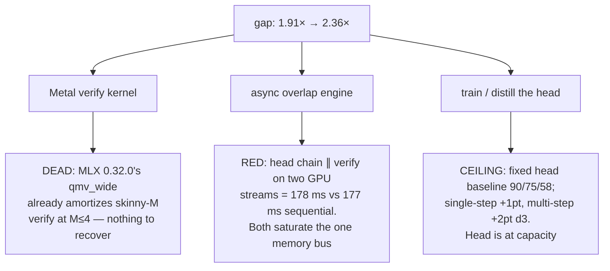
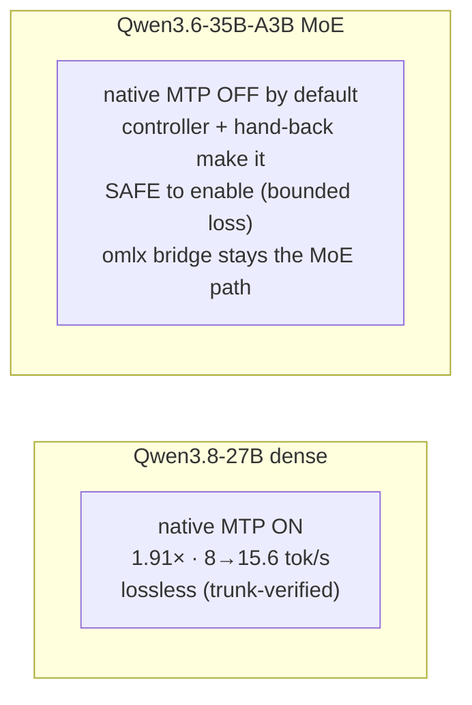
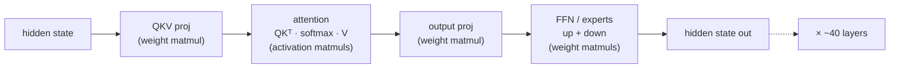
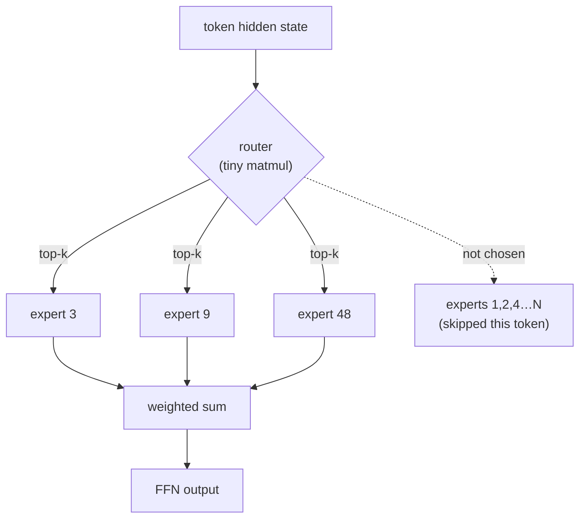
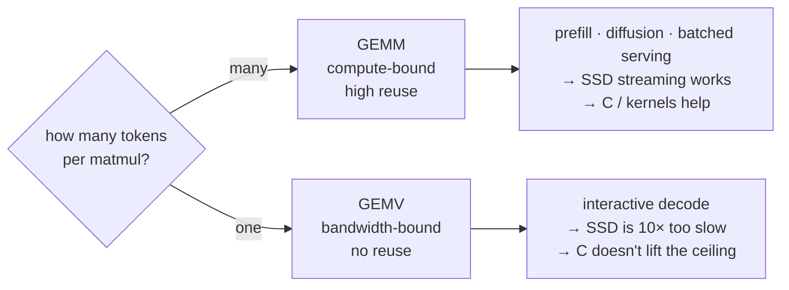

# Multi-token prediction on an M5

*Building self-speculative decoding into Mira's own engine: what it took, what it
won, and the three ways I tried to push it further that didn't work.*

> This is the thread the [decode-wall appendix](#appendix-a-matmul-shapes-and-the-decode-wall) ends
> on. Decode is a GEMV — one token, no reuse, stuck on the memory-bandwidth ramp — and
> the one single-user lever that changes the *shape* of that matmul is speculative
> decoding: let a cheap draft guess a few tokens ahead, then have the big model verify
> all of them in one GEMM-shaped pass, spending the compute that was sitting idle
> anyway. This doc is me actually pulling that thread, end to end, in mira-mlx.
>
> Every number here is from one machine (Qwen3.8-27B and Qwen3.6-35B-A3B, 4-bit, 32 GB
> M5), measured with production down and a fresh in-process engine, `MLX_ENABLE_TF32=0`.
> One machine, two models; don't over-read it.

---

## What MTP is

Multi-token prediction (MTP) is self-speculative decoding where the draft model isn't a
separate small model — it's a tiny extra head bolted onto the big model itself. A single
transformer block (the "MTP head", DeepSeek-V3 style) reads the backbone's last hidden
state plus the token just emitted, and predicts the *next* token. Chain it: feed the
head its own output and it drafts two, three tokens ahead. Then the backbone verifies
the whole guessed run in one forward pass.



The economics are the whole point. A verify over `M` tokens costs almost the same as a
decode over 1 — it's the same weight read, amortized across the window (I measured the
verify forward at **1.03× a single-token forward**; it's essentially free). So if the
head guesses right `m` times, you got `m+1` tokens for the price of ~one decode step.
The draft chain is cheap, the verify is nearly free, and every emitted token is still
chosen by the full backbone — so **correctness is invariant**: a bad head costs speed,
never accuracy. That invariant is what made it safe to run training and benches
unattended.

---

## The bar, and the reframe

The reference is [omlx](omlx-ctl.md) (Jun Kim / @jundot, solo dev, Apache-2.0), which
runs MTP as a monkey-patch on mlx-lm. On this same hardware it gets:

| omlx | speedup | base → MTP tok/s | d1 accept |
|---|---|---|---|
| Qwen3.8-27B **dense** | **2.36×** | 8.1 → 19.13 | ~89% |
| Qwen3.6-35B-A3B **MoE** | **1.38×** | 57.97 → ~73 | ~94% |

I didn't want to *depend* on omlx sitting beside mira-mlx. The goal was never "model
independence" (all of Mira is Qwen-shaped and a real MTP head only deepens that) — it
was **engine self-sufficiency**: mira-mlx owning its own fast decode path. "Novel" here
means self-authored, not different-from-everything: read omlx and the papers to
understand the mechanism, then write original code. So the bar was omlx's numbers, and
losslessness, with the head auto-sourced and zero manual setup.

---

## What I built

The head is a bf16 sidecar (`model-mtp.safetensors`, ~1.6 GB) that sits over the 4-bit
backbone. Mira assembles a combined model dir, loads it lazily, and attaches the head by
an idempotent monkey-patch (mlx-lm builds classes from its own registry, so a subclass
never constructs). The decode loop was the hard part, built in layers over several
sessions:



The rollback is subtler than "trim the KV cache" because Qwen3.6-35B-A3B is a *hybrid*
model: 10 of 40 layers are full attention (trimmable KV), the other 30 are linear
GatedDeltaNet layers carrying a recurrent SSM state that a trim can't undo. Rejected
drafts have to stash each linear layer's pre-forward state and replay only the
recurrence over the accepted slice — no second forward, no lost speedup.

Buffered-emit is the trick that let this ride the real serving path without touching
BatchGenerator's accounting: a cycle produces `m+1` tokens, `_step` hands back exactly
one and buffers the rest, and later `_step` calls drain the buffer forward-free. It
engages only for width-1 text (the production config) and falls back to stock decode for
anything else, so it's never *less* correct than base mlx-lm.

---

## "Lossless" doesn't mean bit-identical

The spec's original gate was "byte-identical to non-MTP greedy." On M5 4-bit that gate
is **infeasible and it's the wrong bar** — and proving that took a while.

The verify projects a `k+1`-token window through the 4-bit quantized matmul, and on M5 a
quantized matmul returns a *different* position-0 result for a width-4 window than for a
width-1 window, from byte-identical position-0 input. This is the standing
[batched-divergence](#appendix-a-matmul-shapes-and-the-decode-wall) behaviour: batch size changes
the kernel path and the last-ULP result. So "MTP output ≠ single-token greedy output" is
guaranteed — but it's meaningless, because single-token greedy is itself just *one*
numerical realization.

I found the token-stream oracle useless with a control: **stock single-token decode
diverges from plain greedy on 176 of 200 tokens** on this hardware. The oracle that
works is **teacher forcing** — one multi-token pass over the arm's own output, checking
each token is the argmax there. By that measure MTP is model-greedy at **199/200,
exactly as lossless as stock decode** (also 199/200 — one irreducible near-tie each).

omlx's own source says the same thing in its own words: its verify kernel "can
occasionally diverge from the unrouted path… the token is still trunk-verified." So the
honest definition, for every MTP implementation on this hardware including the reference,
is **trunk-verified quality-equivalence, not bit-identity**.

---

## The central finding: MTP is a dense win and an MoE trap

The single most important result of the whole workstream is that MTP's payoff is
opposite on the two model types — and it's the decode-wall roofline that explains it.

```
DENSE 27B (bandwidth-bound)              MoE 35B-A3B (compute-bound)

decode ~8 tok/s, ~125 ms/token          decode ~59 tok/s, ~17 ms/token
  slow token → the draft+verify           fast token → the draft head is
  cycle overhead HIDES behind it          itself ~a full forward; the cycle
  → MTP WINS                              overhead SWAMPS the token saved
                                          → MTP LOSES
```

A dense token is a big, slow, bandwidth-bound GEMV; the MTP cycle's fixed overhead (the
draft chain + a wider verify + host sync) is small next to it, so speculation pays. An
MoE token is already cheap — ~3B active params, ~17 ms — so the same fixed overhead is
*larger* than the token it saves. Measured, fully resident (no offload):

| | dense 27B | MoE 35B-A3B |
|---|---|---|
| base decode | 8.3 tok/s | 59.0 tok/s |
| native MTP (served) | **1.91×** | **0.87×** (net-negative) |

That number decided the product: **native MTP is a dense-only feature.** On the MoE it's
off, and the controller (below) exists to make sure "off" happens automatically when it
should. `MIRA_MLX_MTP_ENABLED` defaults to `False` precisely so the MoE loss never
reaches production.

---

## The bug that was most of the win: a norm-shift misclassification

The single biggest lever wasn't a kernel or a retrain — it was a one-line weight-loading
fix. MLX-converted models center their RMSNorm gammas near 1; raw-HuggingFace weights
center them near 0, so the head sidecar (raw-HF) needs a `+1` shift at load. The
sanitizer decided that shift *per key* with a `mean(gamma) < 0.5` heuristic — and three
head norms have raw gammas *above* 0.5:

```
head norm         raw gamma   heuristic says   truth      result if unshifted
q_norm              0.79      "already MLX"     raw-HF     attention Q at 0.79 not 1.79
k_norm              0.78      "already MLX"     raw-HF     attention K at 0.78 not 1.78
mtp.norm            1.25      "already MLX"     raw-HF     head logits flattened
```

So q/k were scaled to ~44% of correct, corrupting the head's own attention in a way that
*compounds down the draft chain* — d1 survives on short context, d2/d3 collapse. The fix
is to stop deciding per-key: a sidecar carries one convention, so read it once from the
norms that *reliably* center near 0 when raw-HF (`pre_fc_*` and the head's layer norms)
and shift every head norm uniformly. This is exactly the misclassification omlx
documents and fixes the same way.

```
dense accept, per draft depth      served speedup
              d1   d2   d3
before fix    83   52   29          1.67×
after  fix    87   71   56          1.91×
                    ↑    ↑
             the gain lands exactly where the
             compounding-attention theory predicts
```

A pure weight-loading fix, no retrain, no kernel, closed ~40% of the gap to omlx's 2.36×
and is the reason dense MTP is worth shipping at all.

---

## The controller: draft when it pays, park when it doesn't

A fixed draft depth is wrong on principle — the right depth depends on how predictable
the current text is, and on the MoE it's often *zero*. So the decode loop runs an
adaptive depth controller, pure host-side bookkeeping (no model change, no kernel), that
ports omlx's `_DepthController`:



`E(d)` is the expected tokens per cycle at depth `d` from an EMA of *conditional* accept
per position; `t[d]` is the measured wall-clock cost. The controller settles at **depth-2
on dense** (and correctly never parks there), and **parks ~93% of cycles on the MoE**,
where it measured that speculation loses. When parking isn't enough — the sequence is
drafting but still losing throughput — a global **hand-back** drops that sequence
entirely to stock decode, detected by *realized throughput* over a window (an earlier
park-fraction signal turned out to be anti-correlated with loss once I benched resident,
not offloaded). Net effect on the MoE: the old fixed-depth net-negative (0.79–0.92×)
becomes bounded-then-neutral (~0.92× worst case, then pure stock), lossless across the
boundary. On dense the whole hand-back path stays dormant.

---

## Three ways I tried to reach omlx's 2.36×, and why each failed

Dense landed at 1.91×; omlx gets 2.36×. I chased that gap three ways. All three are now
closed — and I'm writing them down because each was a real, measured *no*, not a hunch.



**The verify kernel.** omlx ships a custom Metal skinny-M verify kernel, and for a long
time I read that as its real edge. Then I profiled it: on our MLX (0.32.0) `qmv_wide`
already amortizes the skinny-M verify at the depth we run (M≤4), so a hand-rolled kernel
has nothing left to recover. Every "this is the lever" predates that measurement; the
measurement is the answer. Dead unless a future MLX regresses `qmv_wide`.

**The async overlap engine.** The idea: pipeline draft `N+1` behind verify `N` so the
~50 ms draft chain hides behind the ~125 ms verify. I built a feasibility spike before
the engine — ran the head chain and the verify forward on two separate MLX GPU streams
and compared concurrent vs sequential:

```
head chain alone            50.6 ms
verify forward alone       125.2 ms
ideal overlap (perfect)    125.2 ms   ← floor if the head fully hid
sequential                 176.8 ms
concurrent (two streams)   178.4 ms   ← pinned at sequential, +1.7 ms WORSE
```

Both are 4-bit matmuls reading weights out of one unified-memory bus; two command queues
just contend for the same bandwidth. Zero overlap. This is the decode wall again — the
overlap idea silently assumed the head had spare bandwidth to borrow during verify, and
on a bandwidth-bound machine there is none. The sequential design's 1.91× is the true
engine ceiling.

**Training the head.** The last idea was to lift accept by training (Mira's first-ever
training run). The head trains in bf16 with the backbone frozen; correctness stays
invariant, so it's safe. But on the *fixed* head it's exhausted:

| dense accept (chain-ceiling) | d1 | d2 | d3 |
|---|---|---|---|
| fixed-head baseline | 90 | 75 | 58 |
| + single-step retrain | 91 | 76 | 59 |
| + multi-step FastMTP chain loss | 90 | 75 | 60 |

I built the recipe that *should* work — multi-step FastMTP, which unrolls the draft chain
during training and feeds the head its own hidden state, attacking the exposure bias that
single-step training structurally can't (single-step always trains on ground-truth
inputs; the chain never learns to correct its own drift). It moved d3 by two points and
plateaued by epoch 2. The head is at its capacity ceiling: a 424M-param single block
can't reproduce the backbone's deep-context predictions better than this. And that result
also forecloses the *opposite* idea — a smaller, cheaper head to shrink the draft chain —
because a head with *less* capacity can only accept *less*, and the head is already the
binding constraint. The real accept win had already been banked by the norm-shift fix.

---

## Where it landed



| | result |
|---|---|
| Dense native MTP | **1.91×** served (8.3 → 15.6 tok/s), lossless, controller picks depth-2 |
| MoE native MTP | net-negative resident; **off by default**, controller+hand-back bound the loss |
| Losslessness | trunk-verified quality-equivalence (teacher-forced 199/200 = stock) |
| Accept in `/v1/stats` | `accept_rate`, `tokens_per_cycle`, per-depth + depth-chosen histogram |
| Levers closed | verify kernel (dead), async overlap (bandwidth-bound), head training (capacity) |

The honest summary: MTP in mira-mlx is a **self-sufficient dense speedup** — 8 to 15.6
tok/s, lossless, no oMLX.app beside it — and the norm-shift fix was most of that win.
Getting from 1.91× to omlx's 2.36× would take a genuinely bigger drafter (a Qwen3.8-class
step), not any further tuning of this head or this engine. On the MoE, the architecture
itself caps single-stream speculation: a ~3B-active token is too cheap to speculate on,
and the most valuable thing the controller does there is *decide not to*.

---

## References

- Decode-wall companion (why decode is bandwidth-bound, the roofline, the GEMV/GEMM
  divide): [Appendix A](#appendix-a-matmul-shapes-and-the-decode-wall)
- MTP mechanism: DeepSeek-V3 technical report (single MTP head, trunk verification);
  FastMTP (self-distillation multi-step fine-tune); mlx-lm PR #990 (native Qwen3.5/3.6
  MTP base model).
- Reference implementation: omlx (Jun Kim / @jundot, Apache-2.0, omlx.ai) — the
  `_DepthController`, the trunk-verified losslessness stance, and the norm-shift fix are
  its prior art; attribution owed for anything ported. See [omlx-ctl.md](omlx-ctl.md).
- M5 quantized-matmul batch divergence (why bit-identity is the wrong bar):
  [quality-baseline.md](quality-baseline.md), and mlx issues #3897 / #3860 (closed
  won't-fix).
- Custom Metal kernels on Apple Silicon (why the verify kernel doesn't pay at our depth):
  [Appendix B](#appendix-b-custom-kernels-on-apple-silicon-what-they-buy-and-whether-mira-should-write-one).

---

## Appendix A. Matmul shapes and the decode wall

*Why an LLM's speed comes down to the shape of its matrix multiplies, and why "SSD is the new VRAM" is true for diffusion and false for chat.*

> Background: this is the long version behind a reply I left on a LinkedIn post by
> Pawel Bulowski, about antirez's `h3-metal` (native C plus Metal inference for
> MiniMax-H3, a 33B video and audio diffusion model). The post's line was that
> "weights don't need to fit in RAM, they need to arrive on time," and that "SSD
> bandwidth is becoming the new VRAM." For the workload he's running, I think that's
> right. The catch is it flips completely for the workload most of us run locally,
> and the thing that decides which way it goes is a single variable: the shape of the
> matmul. Post: https://lnkd.in/p/eJJKR7hr
>
> The numbers here are from my own machine (Qwen3.6-35B-A3B 4-bit, 32 GB Apple
> Silicon), decode measured at 58 tok/s single stream on 2026-08-13. One machine, one
> model; don't over-read it.

---

### Start in the kitchen

Before any matrices, the homely version. Reading a weight out of memory is like
walking to the pantry for an ingredient. The multiply you do with it is the cooking.

Making fifty pancakes at once, you walk to the pantry once for the flour and use it
fifty times; the walking barely counts, the stove is your limit. That is prefill.
That is antirez's diffusion model too.

Make one pancake, plate it, then start the next, and now you walk to the pantry for
every ingredient of every pancake. The walking is the whole afternoon, and a fancier
stove buys you nothing. That is decode. That is chat.

The rest of this doc is that same picture, with the real shapes.

---

### A transformer is a chain of matmuls



The weights of an LLM are matrices, and one decoder layer is a short run of matrix
multiplies with cheap glue in between (layernorm, softmax, the residual adds, RoPE).
Two kinds of matmul show up, and the difference matters later. Some read the model
weights: the QKV projection, the output projection, the FFN or expert matrices. Those
are where residency and bandwidth bite. The others read the KV cache instead, inside
attention (`Q·Kᵀ` and `softmax·V`), and they grow with how much context you have
already written (that is Case 2).

So where does the time go? Into those matmuls. And the answer changes completely
depending on how many tokens you push through at once.

---

### The one variable that matters: GEMM vs GEMV

Same weight matrix `W`. Push many tokens or one token, and you get two different
machines.

```
PREFILL  (T tokens at once)            DECODE  (1 token at a time)

  W        X          Y                  W        x        y
[d × d] · [d × T]  = [d × T]           [d × d] · [d × 1] = [d × 1]

matrix × MATRIX  → GEMM                matrix × VECTOR  → GEMV
each W element reused T times          each W element used ONCE
math units stay busy                   waiting on memory reads
```

| | Prefill (many tokens) | Decode (one token) |
|---|---|---|
| Matmul shape | matrix × matrix (GEMM) | matrix × vector (GEMV) |
| Weight reuse | ×T (the whole prompt) | ×1 (none) |
| Bottleneck | compute (GPU math units) | memory bandwidth (reading W) |
| Arithmetic intensity | high | ~O(1) |
| Measured here | 500–19,000 tok/s | 58 tok/s, flat |

Feed it the whole prompt and each weight is loaded once and reused across every
column; the math units stay busy (a GEMM, matrix times matrix). Feed it one token and
each weight is read, used for a single multiply-add, and thrown away, with nothing to
reuse it against (a GEMV, matrix times vector). Decode is the second one, and its time
is almost embarrassingly simple:

```
time per token  ≈  (bytes of weights read)  /  (memory bandwidth)
```

That is why people say memory bandwidth is the clock. It is also why the SSD trick
works for antirez: a diffusion block is a GEMM over thousands of image patches,
seconds of GPU work, so a 14 GB/s read of the next block hides behind it with room to
spare. Decode gives you no such room.

---

### The roofline: intensity decides

Arithmetic intensity is FLOPs done per byte loaded from memory. Plot throughput
against it and you get the roofline: a bandwidth-limited ramp on the left, a
compute-limited ceiling on the right, meeting at the ridge point.

```
 throughput
 (FLOP/s)
   ^
   |                _______________  compute ceiling (GPU peak)
   |               /
   |              /
   |   bandwidth /   ← slope = memory bandwidth
   |   limited  /
   |           /
   |    GEMV  •         • GEMM (large T)
   |   (decode)          (prefill / diffusion)
   +---------•-----------•------------------>  arithmetic intensity
           ~4          ridge          (FLOP/byte)
```

The math, on 4-bit weights (half a byte each):

- GEMV (decode). A `d×d` projection reads `0.5·d²` bytes and does `2·d²` FLOPs, so
  intensity is about 4 FLOP/byte. Far to the left of the ridge. Bandwidth-bound.
- GEMM (prefill or diffusion), batch T. Reads the same `0.5·d²` bytes but does
  `2·d²·T` FLOPs, so intensity is about `4·T` FLOP/byte. A few dozen tokens already
  carry you past the ridge into compute-bound.

On Apple Silicon the ridge sits at tens of FLOP/byte, and decode at ~4 is nowhere
near it, so it rides the bandwidth ramp. That is the whole thing in one picture: move
a bandwidth-bound point and neither a faster SSD nor a C rewrite helps you, because
you are on the sloped part of the graph and the slope is the memory bus.

A quick check against the 58 tok/s: about 3B active params at half a byte is roughly
1.5 GB of weight reads per token, and 58 of those a second is ~90 GB/s of weight
traffic alone, before KV and attention. That fits a machine whose peak bandwidth is
in the low hundreds of GB/s, an order of magnitude over a single 14 GB/s SSD (not
40×, which is the number I nearly wrote before doing this arithmetic).

---

### Case 1: MoE routing, the same GEMV but now it is guessing

Qwen3.6-35B-A3B is a Mixture of Experts: 35B parameters in total, about 3B of them
active on any given token (that is what the "A3B" is telling you). Each FFN block
becomes a big pool of expert matrices plus a small router that picks a handful per
token.



Two things follow, and both bear on the SSD argument.

First, decode is still a GEMV, just over the slice the router picked. You touch about
3B params instead of 35B, which is lovely for fitting the model, but the shape has not
changed: one token, no reuse, waiting on memory. MoE makes each token cheaper in
bytes; it does not hand you the reuse that would make streaming pay off.

Second, the sharp one: the router decides which experts you need at runtime, one step
before you need them. antirez's double-buffer works because a diffusion model runs its
blocks in a fixed order he knows in advance, so the background reader always knows what
to fetch next. MoE routing is the opposite. You do not know which experts the next
token wants until the router runs, so you cannot start the SSD read early, and a
random-access read off the disk lands right on the critical path.

```
Diffusion DiT                         MoE decode
block order known in advance          next experts unknown until the
  read block N+1 while GPU              router runs → cannot prefetch
  runs block N   ✅ overlaps            → SSD read is on the critical path ❌
```

So streaming experts off SSD is worse than streaming a diffusion model: you would
stall on a random read every token, with nowhere to hide it. Which
is why the answer, when 35B will not fit, is to keep only the experts you actually
touch hot in RAM and let the rest sit (lazy loading took peak memory from 18.2 to 7.25
GB here). It buys capacity, not speed, and it stays well away from the disk on the hot
path.

---

### Case 2: attention, the matmul that grows on you

The weight matmuls cost the same every token. Attention does not. Every new token has
to look back over every token it already wrote, so the attention matmuls get bigger as
the conversation gets longer.

At decode position `t`, with one query vector `q` and a cache of `t` past keys and
values:

```
scores   =  q · Kᵀ        [1 × d] · [d × t]  =  [1 × t]     ← grows with t
weighted =  softmax(scores) · V   [1 × t] · [t × d] = [1 × d]  ← grows with t
```

```
context t = 1k        t = 16k              t = 64k
K,V read: ~small      16× larger           64× larger

FFN/proj weights:  CONSTANT per token (Case 1)
KV cache reads:    LINEAR in context  ← eventually dominates
```

Both of those read the KV cache from memory, so they are bandwidth-bound too, and they
grow linearly with context. Picture one decode step as two bills added together: a
flat one for reading the active weights (Case 1), and a growing one for reading the KV
cache. Early in a conversation the weights dominate, which is the regime the 58 tok/s
was measured in (a short prompt, 512 to 1024 tokens out). Let the context stretch to
tens of thousands of tokens and the KV bill catches up, and decode slows down.

Worth being exact about what the KV cache actually buys, because it gets over-credited.
It saves you from recomputing attention over the whole prefix on every token, which is
enormous and non-negotiable. It does not make decode compute-efficient: the per-token
projections are still a narrow GEMV, and only batching changes that shape. The cache
removes redundant work; it does not move you off the bandwidth ramp.

That is the reason behind a few knobs that otherwise look arbitrary. The engine runs
the KV cache at 8-bit (`--kv-bits 8`), which halves the bytes read per token and hands
the speed back; it caps how far the cache can grow (`--max-kv-size 128000`); and it
leans on a prompt cache so prefill can skip re-reading a shared prefix. What the prompt
cache cannot do is touch the per-token KV reads during decode. Those are baked into the
attention matmul, and no cache saves you from them.

Put the two cases together and the whole decode budget is a flat weight floor plus a
context ramp, both paid in memory bandwidth, neither one helped by a faster disk or a
lower-level language.

---

### So, back to the post



Prefill and diffusion are GEMMs: plenty of reuse, compute-bound, sitting on the flat
part of the roofline where the GPU's math is the limit. Stream from SSD, hand-write
Metal kernels in C, both pay off, because the bottleneck is math you can overlap or
speed up. That is the world antirez is in, and it holds up there.

Interactive decode is a GEMV: no reuse, bandwidth-bound, stuck on the sloped part. A
faster SSD does not help (14 GB/s is an order of magnitude under RAM), and rewriting
the loop in C does not help either, because the matmul already runs in native Metal;
Python only launches it. The wall is the memory bus, and you do not argue with a bus.

The one lever that moves you between the two is batching. Stack 32 conversations and
decode's GEMV becomes a GEMM with 32-way reuse, climbing back toward compute-bound.
That is why a server doing batch work can stream off SSD while your single chat stream
cannot, and it is the same reason batch size quietly changes the output: batch 1 and
batch 4 take different kernel paths.

So the whole thread, the byte counts, the missing tok/s, the "SSD is the new VRAM," is
one question wearing different hats: how many tokens go through the matmul at once?
Many, and the disk is your friend. One, and the memory bus was the wall all along, and
it still is.

---

### Where this goes next

Batching is really one instance of a bigger rule: efficient inference is mostly the art
of turning the workload into well-fed matrix-matrix work, and keeping it there (that
framing is Utsab Sapkota's, in the references). Batching does it across users. For a
single local user there is another way in, speculative decoding: let a cheap draft guess
a few tokens ahead, then have the big model verify all of them in one GEMM-shaped pass
instead of a GEMV per token, spending the compute that was sitting idle anyway.

On a dense model that is close to free latency. On an MoE it bites again, because
verifying several guessed tokens has to load the union of the experts they route to, so
the reuse leaks straight back out through the same runtime routing that broke prefetch in
Case 1. Predict that routing a step ahead and you might close both holes at once. That
part is not solved. It is the thread I want to pull.

---

### References

- LinkedIn post by Pawel Bulowski, about antirez's `h3-metal`: https://lnkd.in/p/eJJKR7hr
- Utsab Sapkota, *GEMM and GEMV: the hidden divide that shapes LLM inference
  performance*, Medium, 2026 (a clean conceptual companion; the "well-fed matrix-matrix"
  framing is his): https://medium.com/@utsabsapkota4231/gemm-and-gemv-the-hidden-divide-that-shapes-llm-inference-performance-d9e4ba81b871
- Roofline model: Williams, Waterman, Patterson, *Roofline: an insightful visual
  performance model for multicore architectures*, CACM 2009.
- FlexGen (batched SSD-offloaded LLM inference, the compute-bound regime): Sheng et
  al., 2023.
- Mira measured decode: `notes/ssd-weight-streaming-applicability.md` (this repo),
  Qwen3.6-35B-A3B-4bit, single stream, `scripts/bench_standard.py`, 2026-08-13.

---

## Appendix B. Custom kernels on Apple Silicon: what they buy, and whether Mira should write one

Written 2026-08-11, prompted by finding real Metal prefill kernels inside oMLX
and asking why mira-mlx has none. It is an assessment, not a plan. Everything
below is marked as verified, estimated, or not checked, because the useful part
of this question is knowing which is which.

### 1. What a kernel is

A GPU kernel is a small program executed by many threads in parallel over the
elements of a tensor. A framework ships one per primitive: matmul, softmax,
RMSNorm, elementwise add. `y = softmax(x @ w)` dispatches a sequence of
pre-written kernels. A *custom* kernel is one written by hand, in Metal Shading
Language here, instead of composing the framework's built-ins.

### 2. What writing one actually buys

**Fusion, which is the main one.** Every framework op reads its inputs from
device memory and writes its output back. Five chained elementwise ops means
five round trips. A fused kernel does all five while the data sits in registers,
so one round trip. FlashAttention is the canonical case: fusing QK^T, softmax
and ·V means the N×N attention matrix is never written to memory at all, turning
attention from O(N²) memory traffic into O(N). The win is bandwidth, not
arithmetic.

**Exploiting structure the framework cannot see.** A generic matmul does not
know the weights are 4-bit packed into int32, that only k of N experts are
active for this token, or that the recurrence is a Gated DeltaNet. A custom
kernel dequantises in-register and skips the inactive path.

**Cutting dispatch overhead.** Each launch has a fixed cost. At batch 1 with
short sequences, decode can be dispatch-bound rather than compute-bound.

### 3. Stability is a separate axis and it cuts both ways

Kernels change numerics. A fused kernel can accumulate in fp32 while its inputs
are fp16, which improves conditioning. A hand-written kernel is also a new place
for bugs, and a different reduction order gives different results.

The sharpest case for Mira is one this repo already measured: **batch
invariance**. A kernel whose reduction order depends on batch size produces
different tokens at different batch sizes: 23 of 24 prompts here produced
different text at greedy between batch 1 and batch 4, which is why eval scores
carry a batch-composition term.
Custom kernels are the *fix* for that, not the cause. It is the one motivation
here that is about correctness rather than speed, and it is the one that
survives §6 intact.

### 4. The case for, on Apple Silicon

**MLX exposes a custom-kernel API.** `mx.fast.metal_kernel` — **verified
present** in the installed MLX 0.32.0. Metal source goes in as a Python string
and is JIT compiled. No C++ build, no separate toolchain.

**The ecosystem is thinner, so more is unpicked.** A novel architecture gets
CUDA kernels from the community within weeks. MLX often waits months, or never.
oMLX's `custom_kernels/qwen35_prefill/` exists because mlx-lm's Gated DeltaNet
path is generic Python.

**Unified memory removes the host-device copy** that makes some fusion patterns
pointless on discrete GPUs.

### 5. The case against

**The obvious fusions are already done.** `mx.fast` ships `rms_norm`, `rope`,
`layer_norm` and `scaled_dot_product_attention` as custom kernels inside MLX —
**verified** by inspecting the module. The canonical FlashAttention-style wins
are not available; Apple took them. What is left is architecture-specific, which
is a far narrower target and is exactly where oMLX went.

**Decode is bandwidth-bound and no kernel moves that wall.** Generating a token
requires reading the active weights from memory. Fusion helps when making many
passes over data; it does not help when the single unavoidable pass *is* the
cost. This is why the 2026-06-27 rejection of DFlash was right (MTP does not belong in this argument — see §6.5). **See
§6.2 — this argument is weaker than it looks.**

**Maintenance is the real cost.** A custom kernel pins the project to one model
architecture and one MLX version. The standing position across this project is
that carrying fork patches is the thing worth the most effort to avoid, and a
Metal kernel is the most expensive possible version of one.

**Tooling and hardware churn.** No CUTLASS or cuDNN equivalent, thinner
profiling, and on a laptop the GPU also drives the display. This M5 already has
an fp16/bf16 NAX gap with no opt-out.

### 6. Adversarial pass

Five things did not survive review of §1-5.

**6.1 "oMLX's kernels explain its prefill speed" is unsupported.** Inferred from
filenames and `.metallib` presence. No benchmark of mlx-lm's GDN path against
oMLX's kernel has been run. Their existence proves someone believed it was worth
writing, not that it pays. **Not checked.**

**6.2 "Decode is bandwidth-bound" only holds at the roofline — and now it's
measured to.** The argument requires that measured decode throughput sits at the
achievable memory bandwidth. That other half is now established. An MLX
microbench (2026-08-14, prod down, same runtime as decode: `mx.sum` read-stream,
copy, and a decode-representative GEMV that streams a big fp16 weight matrix
once, random inputs so nothing constant-folds) puts this M5's **achievable
ceiling at ≈ 128 GB/s** — read-stream flat at 128 GB/s from 0.5–4 GB, GEMV
plateauing at 125 GB/s. Non-MTP 27B decode demand is ≈ 15 GB/token × 8.12 tok/s
≈ **122 GB/s, or 95% of the ceiling.** Decode really does sit at the roofline, so
the bandwidth-wall argument holds and the reasoning is *not* backwards: there is
no idle bandwidth for a better single-token kernel to capture. **Checked.** (This
is also why MTP pays — §6.5 — it attacks the roofline from the other side, by
reading the weights fewer times, not faster.)

**6.3 "The barrier is low" conflates two things.** Calling
`mx.fast.metal_kernel` is easy. Writing a correct *and faster* tiled kernel with
the right threadgroup memory layout is not, and the API does not help with that
part. Low barrier to entry, unchanged barrier to competence.

**6.4 The strongest objection is opportunity cost, not difficulty.** The
question is not whether a kernel can be written but whether it is the best use
of the time. On 2026-08-11 a cache change took one turn from 48.7s to 5.0s and a
second one took conversation openers from 10% to 78.7% reuse. No kernel is going
to approach either. Step 4 of the roadmap already gates kernels behind
profiling, and that gate is doing real work.

**6.5 MTP does not belong in the bandwidth-wall argument (§5).** The 2026-06-27
rejection of MTP was practical, not physical: the 4-bit checkpoint had its
`mtp.*` head stripped and re-converting a ~20 GB checkpoint was not worth it
then. Baked back and run on omlx (2026-08-15), MTP gives the dense 27B **8.1 →
19.1 tok/s (2.36×)** and the 35B-A3B MoE 1.34×, with no kernel. It wins
*because* decode is bandwidth-bound: a verify step amortises one weight-read
across several speculated tokens, using the ALU that single-token decode leaves
idle. So a non-kernel technique already moves the effective decode wall — which
cuts the same way as §6.4, the wins that matter here are not kernels. It does
**not** settle §6.2 (achievable bandwidth is still unmeasured) and it is not an
argument for writing one.

### 7. Position

Not now, and the reason is §6.4 rather than difficulty. The order that survives
scrutiny is: cache work, then measure, then consider a kernel only if profiling
names the GDN prefill chunk as the hot spot.

Two things would change this:

- **§6.2 resolves against the current position.** It didn't — measured: decode
  sits at ≈ 95% of M5's ≈ 128 GB/s achievable bandwidth, so there is no headroom
  a single-token kernel could reclaim and the "bandwidth wall" holds. This bullet
  is now closed; it would only reopen if a faster resident-set or weight-format
  change lifted the ceiling itself.
- **Reproducible evals need batch invariance.** That is a correctness
  requirement, independent of speed, and no amount of cache work addresses it.
